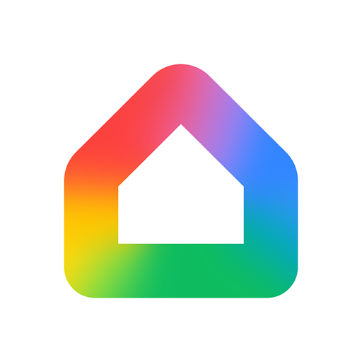
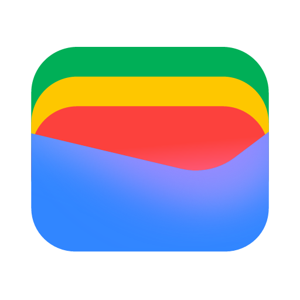
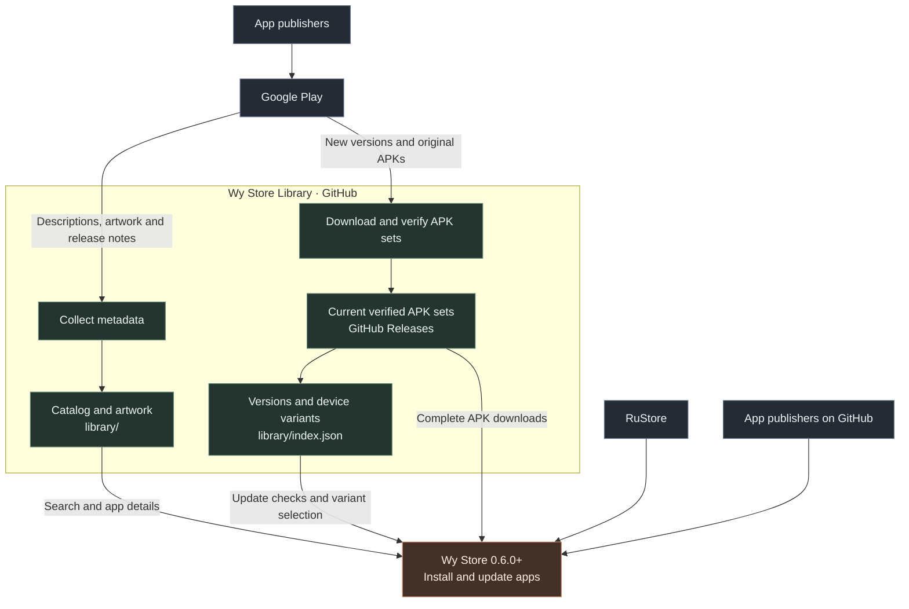

**An application library for [Wy Store](https://github.com/wyrtensi/wystore).**

App descriptions, screenshots and release notes from Google Play. 
A companion catalog with verified original app packages.

**Available in [Wy Store 0.6.0 and newer](https://github.com/wyrtensi/wystore/releases/tag/v0.6.0).**
Install selected apps unavailable in the Russian Google Play catalog without
signing in to Google. The library is a built-in Wy Store source alongside
RuStore and GitHub; app service availability remains subject to publisher rules.

[**Wy Store**](https://github.com/wyrtensi/wystore) · [**Download Wy Store**](https://github.com/wyrtensi/wystore/releases/latest/download/wystore.apk) · [**Catalog**](library/catalog.json) · [**APK releases**](https://github.com/wyrtensi/wystore-library/releases)

## Explore the library

**Multiple device variants, one current release per application.**
Click a version to open that application's current APK set. App names lead to
saved descriptions, artwork and release notes.

The registry requests 18 delivery samples across these architectures, each in
English and Russian. The table below describes requested coverage; an app gains
a variant only after synchronization downloads and verifies its complete APK set:

| Device class | Sampling Android version | Architecture | Sampling density |
| --- | --- | --- | --- |
| ARM64 | Android 9, 10, 12, 13, 15, 16 (SDK 28/29/31/33/35/36) | `arm64-v8a` | 320 / 420 dpi |
| 32-bit ARM | Android 8, 12 (SDK 26/31) | `armeabi-v7a` | 320 dpi |
| x86-64 | Android 13 (SDK 33) | `x86_64` | 320 dpi |

These are delivery samples, not phone-model restrictions. A client selects a
complete compatible set using its verified Android, ABI, language, density,
feature and split requirements. Available variants differ by application;
the library does not cover every Android device. See the
[device variants contract](docs/device-variants-contract.md).

<!-- APP_CATALOG:START -->

**63 applications · 704 verified device variants · daily checks**

| Application | Collection | Current version | Device variants | Google Play |
| --- | --- | --- | --- | --- |
|  [ABC News](library/apps/com.abc.abcnews/metadata.json) | News | [8.98.2](https://github.com/wyrtensi/wystore-library/releases/tag/com.abc.abcnews-library) | [10 variants](https://github.com/wyrtensi/wystore-library/releases/tag/com.abc.abcnews-library) | [Google Play](https://play.google.com/store/apps/details?id=com.abc.abcnews) |
|  [adidas Running](library/apps/com.runtastic.android/metadata.json) | Health &amp; fitness | [14.12.1](https://github.com/wyrtensi/wystore-library/releases/tag/com.runtastic.android-library) | [10 variants](https://github.com/wyrtensi/wystore-library/releases/tag/com.runtastic.android-library) | [Google Play](https://play.google.com/store/apps/details?id=com.runtastic.android) |
|  [Amazon Alexa](library/apps/com.amazon.dee.app/metadata.json) | Smart home | [2.2.730155.0](https://github.com/wyrtensi/wystore-library/releases/tag/com.amazon.dee.app-library) | [10 variants](https://github.com/wyrtensi/wystore-library/releases/tag/com.amazon.dee.app-library) | [Google Play](https://play.google.com/store/apps/details?id=com.amazon.dee.app) |
|  [Amazon Fire TV](library/apps/com.amazon.storm.lightning.client.aosp/metadata.json) | Entertainment | [4.9.1](https://github.com/wyrtensi/wystore-library/releases/tag/com.amazon.storm.lightning.client.aosp-library) | [16 variants](https://github.com/wyrtensi/wystore-library/releases/tag/com.amazon.storm.lightning.client.aosp-library) | [Google Play](https://play.google.com/store/apps/details?id=com.amazon.storm.lightning.client.aosp) |
|  [Amazon Flex](library/apps/com.amazon.flex.rabbit/metadata.json) | Work | [3.145.1.86.0](https://github.com/wyrtensi/wystore-library/releases/tag/com.amazon.flex.rabbit-library) | [6 variants](https://github.com/wyrtensi/wystore-library/releases/tag/com.amazon.flex.rabbit-library) | [Google Play](https://play.google.com/store/apps/details?id=com.amazon.flex.rabbit) |
|  [Amazon Kindle](library/apps/com.amazon.kindle/metadata.json) | Books | [8.159.0.100(2.0.115180.0)](https://github.com/wyrtensi/wystore-library/releases/tag/com.amazon.kindle-library) | [16 variants](https://github.com/wyrtensi/wystore-library/releases/tag/com.amazon.kindle-library) | [Google Play](https://play.google.com/store/apps/details?id=com.amazon.kindle) |
|  [Amazon Music](library/apps/com.amazon.mp3/metadata.json) | Music | [26.40.0](https://github.com/wyrtensi/wystore-library/releases/tag/com.amazon.mp3-library) | [18 variants](https://github.com/wyrtensi/wystore-library/releases/tag/com.amazon.mp3-library) | [Google Play](https://play.google.com/store/apps/details?id=com.amazon.mp3) |
|  [Amazon Prime Video](library/apps/com.amazon.avod.thirdpartyclient/metadata.json) | Video | [3.0.480.847](https://github.com/wyrtensi/wystore-library/releases/tag/com.amazon.avod.thirdpartyclient-library) | [14 variants](https://github.com/wyrtensi/wystore-library/releases/tag/com.amazon.avod.thirdpartyclient-library) | [Google Play](https://play.google.com/store/apps/details?id=com.amazon.avod.thirdpartyclient) |
|  [Amazon Shopping](library/apps/com.amazon.mShop.android.shopping/metadata.json) | Shopping | [32.20.2.100](https://github.com/wyrtensi/wystore-library/releases/tag/com.amazon.mShop.android.shopping-library) | [8 variants](https://github.com/wyrtensi/wystore-library/releases/tag/com.amazon.mShop.android.shopping-library) | [Google Play](https://play.google.com/store/apps/details?id=com.amazon.mShop.android.shopping) |
|  [Avast One](library/apps/com.avast.android.mobilesecurity/metadata.json) | Security | [26.21.0.261104066](https://github.com/wyrtensi/wystore-library/releases/tag/com.avast.android.mobilesecurity-library) | [10 variants](https://github.com/wyrtensi/wystore-library/releases/tag/com.avast.android.mobilesecurity-library) | [Google Play](https://play.google.com/store/apps/details?id=com.avast.android.mobilesecurity) |
|  [AVG AntiVirus](library/apps/com.antivirus/metadata.json) | Security | [26.18.0.261002870](https://github.com/wyrtensi/wystore-library/releases/tag/com.antivirus-library) | [10 variants](https://github.com/wyrtensi/wystore-library/releases/tag/com.antivirus-library) | [Google Play](https://play.google.com/store/apps/details?id=com.antivirus) |
|  [Badoo](library/apps/com.badoo.mobile/metadata.json) | Dating | [5.492.0](https://github.com/wyrtensi/wystore-library/releases/tag/com.badoo.mobile-library) | [8 variants](https://github.com/wyrtensi/wystore-library/releases/tag/com.badoo.mobile-library) | [Google Play](https://play.google.com/store/apps/details?id=com.badoo.mobile) |
|  [Bilibili](library/apps/com.bilibili.app.in/metadata.json) | Video | [6.8.0](https://github.com/wyrtensi/wystore-library/releases/tag/com.bilibili.app.in-library) | [8 variants](https://github.com/wyrtensi/wystore-library/releases/tag/com.bilibili.app.in-library) | [Google Play](https://play.google.com/store/apps/details?id=com.bilibili.app.in) |
|  [Brave](library/apps/com.brave.browser/metadata.json) | Browsers | [1.99.56](https://github.com/wyrtensi/wystore-library/releases/tag/com.brave.browser-library) | [10 variants](https://github.com/wyrtensi/wystore-library/releases/tag/com.brave.browser-library) | [Google Play](https://play.google.com/store/apps/details?id=com.brave.browser) |
|  [Bumble](library/apps/com.bumble.app/metadata.json) | Dating | [5.492.0](https://github.com/wyrtensi/wystore-library/releases/tag/com.bumble.app-library) | [8 variants](https://github.com/wyrtensi/wystore-library/releases/tag/com.bumble.app-library) | [Google Play](https://play.google.com/store/apps/details?id=com.bumble.app) |
|  [Canva](library/apps/com.canva.editor/metadata.json) | Creativity | [2.386.0](https://github.com/wyrtensi/wystore-library/releases/tag/com.canva.editor-library) | [10 variants](https://github.com/wyrtensi/wystore-library/releases/tag/com.canva.editor-library) | [Google Play](https://play.google.com/store/apps/details?id=com.canva.editor) |
|  [Cash App](library/apps/com.squareup.cash/metadata.json) | Finance | [5.77.0](https://github.com/wyrtensi/wystore-library/releases/tag/com.squareup.cash-library) | [10 variants](https://github.com/wyrtensi/wystore-library/releases/tag/com.squareup.cash-library) | [Google Play](https://play.google.com/store/apps/details?id=com.squareup.cash) |
|  [ChatGPT](library/apps/com.openai.chatgpt/metadata.json) | AI assistants | [1.2026.307](https://github.com/wyrtensi/wystore-library/releases/tag/com.openai.chatgpt-library) | [10 variants](https://github.com/wyrtensi/wystore-library/releases/tag/com.openai.chatgpt-library) | [Google Play](https://play.google.com/store/apps/details?id=com.openai.chatgpt) |
|  [Claude](library/apps/com.anthropic.claude/metadata.json) | AI assistants | [1.261111.19](https://github.com/wyrtensi/wystore-library/releases/tag/com.anthropic.claude-library) | [10 variants](https://github.com/wyrtensi/wystore-library/releases/tag/com.anthropic.claude-library) | [Google Play](https://play.google.com/store/apps/details?id=com.anthropic.claude) |
|  [DeepL Translate](library/apps/com.deepl.mobiletranslator/metadata.json) | Productivity | [26.45](https://github.com/wyrtensi/wystore-library/releases/tag/com.deepl.mobiletranslator-library) | [10 variants](https://github.com/wyrtensi/wystore-library/releases/tag/com.deepl.mobiletranslator-library) | [Google Play](https://play.google.com/store/apps/details?id=com.deepl.mobiletranslator) |
|  [Deezer](library/apps/deezer.android.app/metadata.json) | Music | [9.0.26.3](https://github.com/wyrtensi/wystore-library/releases/tag/deezer.android.app-library) | [10 variants](https://github.com/wyrtensi/wystore-library/releases/tag/deezer.android.app-library) | [Google Play](https://play.google.com/store/apps/details?id=deezer.android.app) |
|  [Disney+](library/apps/com.disney.disneyplus/metadata.json) | Video | [26.20.0+rc3-2026.11.02](https://github.com/wyrtensi/wystore-library/releases/tag/com.disney.disneyplus-library) | [10 variants](https://github.com/wyrtensi/wystore-library/releases/tag/com.disney.disneyplus-library) | [Google Play](https://play.google.com/store/apps/details?id=com.disney.disneyplus) |
|  [Facebook](library/apps/com.facebook.katana/metadata.json) | Social | [587.0.0.39.55](https://github.com/wyrtensi/wystore-library/releases/tag/com.facebook.katana-library) | [10 variants](https://github.com/wyrtensi/wystore-library/releases/tag/com.facebook.katana-library) | [Google Play](https://play.google.com/store/apps/details?id=com.facebook.katana) |
|  [Filmigo](library/apps/com.funcamerastudio.videomaker/metadata.json) | Creativity | [6.7.9.2](https://github.com/wyrtensi/wystore-library/releases/tag/com.funcamerastudio.videomaker-library) | [8 variants](https://github.com/wyrtensi/wystore-library/releases/tag/com.funcamerastudio.videomaker-library) | [Google Play](https://play.google.com/store/apps/details?id=com.funcamerastudio.videomaker) |
|  [Firefox](library/apps/org.mozilla.firefox/metadata.json) | Browsers | [160.0](https://github.com/wyrtensi/wystore-library/releases/tag/org.mozilla.firefox-library) | [18 variants](https://github.com/wyrtensi/wystore-library/releases/tag/org.mozilla.firefox-library) | [Google Play](https://play.google.com/store/apps/details?id=org.mozilla.firefox) |
|  [Fitbit](library/apps/com.fitbit.FitbitMobile/metadata.json) | Health &amp; fitness | [5.12.1.health-mobile-1104141583-1017635139](https://github.com/wyrtensi/wystore-library/releases/tag/com.fitbit.FitbitMobile-library) | [10 variants](https://github.com/wyrtensi/wystore-library/releases/tag/com.fitbit.FitbitMobile-library) | [Google Play](https://play.google.com/store/apps/details?id=com.fitbit.FitbitMobile) |
|  [Google Earth](library/apps/com.google.earth/metadata.json) | Maps | [10.125.82.01](https://github.com/wyrtensi/wystore-library/releases/tag/com.google.earth-library) | [18 variants](https://github.com/wyrtensi/wystore-library/releases/tag/com.google.earth-library) | [Google Play](https://play.google.com/store/apps/details?id=com.google.earth) |
|  [Google Gemini](library/apps/com.google.android.apps.bard/metadata.json) | AI assistants | [1.0.995038376](https://github.com/wyrtensi/wystore-library/releases/tag/com.google.android.apps.bard-library) | [10 variants](https://github.com/wyrtensi/wystore-library/releases/tag/com.google.android.apps.bard-library) | [Google Play](https://play.google.com/store/apps/details?id=com.google.android.apps.bard) |
|  [Google Home](library/apps/com.google.android.apps.chromecast.app/metadata.json) | Smart home | [4.37.27.0](https://github.com/wyrtensi/wystore-library/releases/tag/com.google.android.apps.chromecast.app-library) | [18 variants](https://github.com/wyrtensi/wystore-library/releases/tag/com.google.android.apps.chromecast.app-library) | [Google Play](https://play.google.com/store/apps/details?id=com.google.android.apps.chromecast.app) |
|  [Google Wallet](library/apps/com.google.android.apps.walletnfcrel/metadata.json) | Finance | [26.45.1018379642](https://github.com/wyrtensi/wystore-library/releases/tag/com.google.android.apps.walletnfcrel-library) | [10 variants](https://github.com/wyrtensi/wystore-library/releases/tag/com.google.android.apps.walletnfcrel-library) | [Google Play](https://play.google.com/store/apps/details?id=com.google.android.apps.walletnfcrel) |
|  [Grok](library/apps/ai.x.grok/metadata.json) | AI assistants | [1.2.56-release.00](https://github.com/wyrtensi/wystore-library/releases/tag/ai.x.grok-library) | [10 variants](https://github.com/wyrtensi/wystore-library/releases/tag/ai.x.grok-library) | [Google Play](https://play.google.com/store/apps/details?id=ai.x.grok) |
|  [HBO Max](library/apps/com.wbd.stream/metadata.json) | Video | [22.0.0.321](https://github.com/wyrtensi/wystore-library/releases/tag/com.wbd.stream-library) | [10 variants](https://github.com/wyrtensi/wystore-library/releases/tag/com.wbd.stream-library) | [Google Play](https://play.google.com/store/apps/details?id=com.wbd.stream) |
|  [Instagram](library/apps/com.instagram.android/metadata.json) | Social | [455.0.0.51.72](https://github.com/wyrtensi/wystore-library/releases/tag/com.instagram.android-library) | [14 variants](https://github.com/wyrtensi/wystore-library/releases/tag/com.instagram.android-library) | [Google Play](https://play.google.com/store/apps/details?id=com.instagram.android) |
|  [Klarna](library/apps/com.myklarnamobile/metadata.json) | Shopping | [26.46.334](https://github.com/wyrtensi/wystore-library/releases/tag/com.myklarnamobile-library) | [10 variants](https://github.com/wyrtensi/wystore-library/releases/tag/com.myklarnamobile-library) | [Google Play](https://play.google.com/store/apps/details?id=com.myklarnamobile) |
|  [Kwai](library/apps/com.kwai.video/metadata.json) | Video | [13.10.10.647103](https://github.com/wyrtensi/wystore-library/releases/tag/com.kwai.video-library) | [8 variants](https://github.com/wyrtensi/wystore-library/releases/tag/com.kwai.video-library) | [Google Play](https://play.google.com/store/apps/details?id=com.kwai.video) |
|  [LINE](library/apps/jp.naver.line.android/metadata.json) | Messaging | [26.17.1](https://github.com/wyrtensi/wystore-library/releases/tag/jp.naver.line.android-library) | [16 variants](https://github.com/wyrtensi/wystore-library/releases/tag/jp.naver.line.android-library) | [Google Play](https://play.google.com/store/apps/details?id=jp.naver.line.android) |
|  [LinkedIn](library/apps/com.linkedin.android/metadata.json) | Social | [4.1.1270](https://github.com/wyrtensi/wystore-library/releases/tag/com.linkedin.android-library) | [14 variants](https://github.com/wyrtensi/wystore-library/releases/tag/com.linkedin.android-library) | [Google Play](https://play.google.com/store/apps/details?id=com.linkedin.android) |
|  [McDonald&#x27;s](library/apps/com.mcdonalds.mobileapp/metadata.json) | Food &amp; drink | [3.53.0](https://github.com/wyrtensi/wystore-library/releases/tag/com.mcdonalds.mobileapp-library) | [14 variants](https://github.com/wyrtensi/wystore-library/releases/tag/com.mcdonalds.mobileapp-library) | [Google Play](https://play.google.com/store/apps/details?id=com.mcdonalds.mobileapp) |
|  [Meta AI](library/apps/com.facebook.stella/metadata.json) | AI assistants | [298.0.0.28.160](https://github.com/wyrtensi/wystore-library/releases/tag/com.facebook.stella-library) | [8 variants](https://github.com/wyrtensi/wystore-library/releases/tag/com.facebook.stella-library) | [Google Play](https://play.google.com/store/apps/details?id=com.facebook.stella) |
|  [Microsoft Copilot](library/apps/com.microsoft.office.officehubrow/metadata.json) | AI assistants | [16.0.20625.20022](https://github.com/wyrtensi/wystore-library/releases/tag/com.microsoft.office.officehubrow-library) | [8 variants](https://github.com/wyrtensi/wystore-library/releases/tag/com.microsoft.office.officehubrow-library) | [Google Play](https://play.google.com/store/apps/details?id=com.microsoft.office.officehubrow) |
|  [myChevrolet](library/apps/com.gm.chevrolet.nomad.ownership/metadata.json) | Auto &amp; vehicles | [8.21.0](https://github.com/wyrtensi/wystore-library/releases/tag/com.gm.chevrolet.nomad.ownership-library) | [10 variants](https://github.com/wyrtensi/wystore-library/releases/tag/com.gm.chevrolet.nomad.ownership-library) | [Google Play](https://play.google.com/store/apps/details?id=com.gm.chevrolet.nomad.ownership) |
|  [MyFitnessPal](library/apps/com.myfitnesspal.android/metadata.json) | Health &amp; fitness | [26.45.0](https://github.com/wyrtensi/wystore-library/releases/tag/com.myfitnesspal.android-library) | [8 variants](https://github.com/wyrtensi/wystore-library/releases/tag/com.myfitnesspal.android-library) | [Google Play](https://play.google.com/store/apps/details?id=com.myfitnesspal.android) |
|  [Netflix](library/apps/com.netflix.mediaclient/metadata.json) | Video | [9.92.0 build 9 74772](https://github.com/wyrtensi/wystore-library/releases/tag/com.netflix.mediaclient-library) | [16 variants](https://github.com/wyrtensi/wystore-library/releases/tag/com.netflix.mediaclient-library) | [Google Play](https://play.google.com/store/apps/details?id=com.netflix.mediaclient) |
|  [NewsBreak](library/apps/com.particlenews.newsbreak/metadata.json) | News | [26.46.0](https://github.com/wyrtensi/wystore-library/releases/tag/com.particlenews.newsbreak-library) | [10 variants](https://github.com/wyrtensi/wystore-library/releases/tag/com.particlenews.newsbreak-library) | [Google Play](https://play.google.com/store/apps/details?id=com.particlenews.newsbreak) |
|  [Norton 360](library/apps/com.symantec.mobilesecurity/metadata.json) | Security | [26.21.0.261103359](https://github.com/wyrtensi/wystore-library/releases/tag/com.symantec.mobilesecurity-library) | [10 variants](https://github.com/wyrtensi/wystore-library/releases/tag/com.symantec.mobilesecurity-library) | [Google Play](https://play.google.com/store/apps/details?id=com.symantec.mobilesecurity) |
|  [Perplexity](library/apps/ai.perplexity.app.android/metadata.json) | AI assistants | [2.104.0](https://github.com/wyrtensi/wystore-library/releases/tag/ai.perplexity.app.android-library) | [10 variants](https://github.com/wyrtensi/wystore-library/releases/tag/ai.perplexity.app.android-library) | [Google Play](https://play.google.com/store/apps/details?id=ai.perplexity.app.android) |
|  [Planfix](library/apps/com.planfixng/metadata.json) | Productivity | [0.74.2](https://github.com/wyrtensi/wystore-library/releases/tag/com.planfixng-library) | [10 variants](https://github.com/wyrtensi/wystore-library/releases/tag/com.planfixng-library) | [Google Play](https://play.google.com/store/apps/details?id=com.planfixng) |
|  [Reuters](library/apps/com.thomsonreuters.reuters/metadata.json) | News | [7.51.0](https://github.com/wyrtensi/wystore-library/releases/tag/com.thomsonreuters.reuters-library) | [10 variants](https://github.com/wyrtensi/wystore-library/releases/tag/com.thomsonreuters.reuters-library) | [Google Play](https://play.google.com/store/apps/details?id=com.thomsonreuters.reuters) |
|  [Simply Guitar](library/apps/com.joytunes.simplyguitar/metadata.json) | Music education | [9.8.1](https://github.com/wyrtensi/wystore-library/releases/tag/com.joytunes.simplyguitar-library) | [8 variants](https://github.com/wyrtensi/wystore-library/releases/tag/com.joytunes.simplyguitar-library) | [Google Play](https://play.google.com/store/apps/details?id=com.joytunes.simplyguitar) |
|  [Simply Piano](library/apps/com.joytunes.simplypiano/metadata.json) | Music education | [7.33.11](https://github.com/wyrtensi/wystore-library/releases/tag/com.joytunes.simplypiano-library) | [10 variants](https://github.com/wyrtensi/wystore-library/releases/tag/com.joytunes.simplypiano-library) | [Google Play](https://play.google.com/store/apps/details?id=com.joytunes.simplypiano) |
|  [SmartNews](library/apps/jp.gocro.smartnews.android/metadata.json) | News | [26.10.41](https://github.com/wyrtensi/wystore-library/releases/tag/jp.gocro.smartnews.android-library) | [10 variants](https://github.com/wyrtensi/wystore-library/releases/tag/jp.gocro.smartnews.android-library) | [Google Play](https://play.google.com/store/apps/details?id=jp.gocro.smartnews.android) |
|  [Spotify](library/apps/com.spotify.music/metadata.json) | Music | [9.2.0.2053](https://github.com/wyrtensi/wystore-library/releases/tag/com.spotify.music-library) | [18 variants](https://github.com/wyrtensi/wystore-library/releases/tag/com.spotify.music-library) | [Google Play](https://play.google.com/store/apps/details?id=com.spotify.music) |
|  [Starbucks (US)](library/apps/com.starbucks.mobilecard/metadata.json) | Food &amp; drink | [6.135](https://github.com/wyrtensi/wystore-library/releases/tag/com.starbucks.mobilecard-library) | [14 variants](https://github.com/wyrtensi/wystore-library/releases/tag/com.starbucks.mobilecard-library) | [Google Play](https://play.google.com/store/apps/details?id=com.starbucks.mobilecard) |
|  [Strava](library/apps/com.strava/metadata.json) | Health &amp; fitness | [489.9](https://github.com/wyrtensi/wystore-library/releases/tag/com.strava-library) | [8 variants](https://github.com/wyrtensi/wystore-library/releases/tag/com.strava-library) | [Google Play](https://play.google.com/store/apps/details?id=com.strava) |
|  [Temu](library/apps/com.einnovation.temu/metadata.json) | Shopping | [4.97.0](https://github.com/wyrtensi/wystore-library/releases/tag/com.einnovation.temu-library) | [16 variants](https://github.com/wyrtensi/wystore-library/releases/tag/com.einnovation.temu-library) | [Google Play](https://play.google.com/store/apps/details?id=com.einnovation.temu) |
|  [TikTok](library/apps/com.zhiliaoapp.musically/metadata.json) | Social | [47.7.3](https://github.com/wyrtensi/wystore-library/releases/tag/com.zhiliaoapp.musically-library) | [16 variants](https://github.com/wyrtensi/wystore-library/releases/tag/com.zhiliaoapp.musically-library) | [Google Play](https://play.google.com/store/apps/details?id=com.zhiliaoapp.musically) |
|  [Tinder](library/apps/com.tinder/metadata.json) | Dating | [17.42.1](https://github.com/wyrtensi/wystore-library/releases/tag/com.tinder-library) | [10 variants](https://github.com/wyrtensi/wystore-library/releases/tag/com.tinder-library) | [Google Play](https://play.google.com/store/apps/details?id=com.tinder) |
|  [Vivaldi](library/apps/com.vivaldi.browser/metadata.json) | Browsers | [8.3.4192.71](https://github.com/wyrtensi/wystore-library/releases/tag/com.vivaldi.browser-library) | [10 variants](https://github.com/wyrtensi/wystore-library/releases/tag/com.vivaldi.browser-library) | [Google Play](https://play.google.com/store/apps/details?id=com.vivaldi.browser) |
|  [Walmart](library/apps/com.walmart.android/metadata.json) | Shopping | [26.42.2](https://github.com/wyrtensi/wystore-library/releases/tag/com.walmart.android-library) | [10 variants](https://github.com/wyrtensi/wystore-library/releases/tag/com.walmart.android-library) | [Google Play](https://play.google.com/store/apps/details?id=com.walmart.android) |
|  [WeightWatchers](library/apps/com.weightwatchers.mobile/metadata.json) | Health &amp; fitness | [11.32.0](https://github.com/wyrtensi/wystore-library/releases/tag/com.weightwatchers.mobile-library) | [8 variants](https://github.com/wyrtensi/wystore-library/releases/tag/com.weightwatchers.mobile-library) | [Google Play](https://play.google.com/store/apps/details?id=com.weightwatchers.mobile) |
|  [WhatsApp](library/apps/com.whatsapp/metadata.json) | Messaging | [2.26.44.90](https://github.com/wyrtensi/wystore-library/releases/tag/com.whatsapp-library) | [10 variants](https://github.com/wyrtensi/wystore-library/releases/tag/com.whatsapp-library) | [Google Play](https://play.google.com/store/apps/details?id=com.whatsapp) |
|  [Wish](library/apps/com.contextlogic.wish/metadata.json) | Shopping | [26.7.9](https://github.com/wyrtensi/wystore-library/releases/tag/com.contextlogic.wish-library) | [8 variants](https://github.com/wyrtensi/wystore-library/releases/tag/com.contextlogic.wish-library) | [Google Play](https://play.google.com/store/apps/details?id=com.contextlogic.wish) |
|  [Xender](library/apps/cn.xender/metadata.json) | Tools | [19.0.0.prime](https://github.com/wyrtensi/wystore-library/releases/tag/cn.xender-library) | [18 variants](https://github.com/wyrtensi/wystore-library/releases/tag/cn.xender-library) | [Google Play](https://play.google.com/store/apps/details?id=cn.xender) |

<!-- APP_CATALOG:END -->

The table follows the [update feed](library/index.json) and refreshes automatically
after successful checks. Descriptions and available release notes are saved in
Russian and English; screenshot collections are stored alongside each app.

<strong>Browse app screenshots</strong>

<table>
<tr>
<td width="50%" align="center" valign="top"><strong>Planfix</strong>  

</td>
<td width="50%" align="center" valign="top"><strong>Vivaldi</strong>  

</td>
</tr>
<tr>
<td width="50%" align="center" valign="top"><strong>Brave</strong>  

</td>
<td width="50%" align="center" valign="top"><strong>Firefox</strong>  

</td>
</tr>
</table>

Screenshots and icons come from the app publishers on Google Play. Full image sets are saved alongside each app’s metadata.

## Where the apps come from

This library uses **Google Play** as its source. Scheduled GitHub Actions collect metadata and publish verified original app packages. Wy Store reads the catalog for discovery, checks the shared index for updates, and downloads complete compatible APK sets from the application's release.

All arrows show implemented flows. The library is a dedicated Wy Store source;
ordinary GitHub repositories keep their existing release-based behavior.

### Using the library in Wy Store

- Enable the Wy Store source in app source settings, then use the **Wy Store** search filter or the **Wy Store** category (**Зарубежные** in Russian) directly after GitHub on Home.
- Where the same package exists in several sources, its app card offers source selection. Compatible signatures allow updates; an incompatible signature requires an explicitly confirmed reinstall that can remove local app data.
- Wy Store checks native version codes before downloading and selects a complete APK set for the device's Android version, architecture and other compatibility requirements. One index checks the whole library without parsing every release page.

### Current availability

| Component | Status |
| --- | --- |
| Metadata, artwork and release notes | Scheduled refresh once daily; see the [catalog](library/catalog.json) for collected apps |
| Verified APKs | Checked once daily; see the [APK index](library/index.json) for published sets |
| Library integration with Wy Store | Available since [0.6.0](https://github.com/wyrtensi/wystore/releases/tag/v0.6.0): discovery, source selection, compatible APK installation and updates |

The [app catalog](library/catalog.json) and [APK index](library/index.json) are separate. The APK index points to complete verified releases and their public manifests. Descriptions, screenshots and release notes can also be browsed independently.

## How updates are prepared

1. **Check the version first.** The pipeline reads `versionCode` before downloading. Equal and older versions are skipped.
2. **Verify the package set.** Every base and split APK is checked for hashes, package name, version and signing certificate. Signing-key changes require review.
3. **Publish complete variants.** Verified files go into the application's stable release before the index is updated. Published assets are never overwritten.

Each app has one stable `<package>-library` release containing its current
verified variants and shared APK files. Variants can have different version
codes. Unchanged variants reuse their verified files; changing the sampling
configuration requires fresh verification even when the version is unchanged.
After publishing complete sets and committing the index, cleanup removes
unreferenced assets and obsolete managed releases. If cleanup is interrupted,
the next run resumes it without downloading or uploading unchanged sets again.

Metadata refresh runs daily at **02:43 UTC** and APK checks at **03:17 UTC**
(07:43 and 08:17 in Yekaterinburg). GitHub schedules can be delayed; manual runs
remain available.

The pipeline preserves original publisher signatures and split packages without
merging or re-signing them. Install the base APK and every split listed in one
selected variant together; do not mix variants or assume the base APK works
alone. Sampling Android versions are not minimum-version promises: use the
verified requirements of the actual delivered set. x86 variants are not currently
sampled. Regional availability, login, licensing and Google Play services
requirements remain separate from APK delivery. See
[split APKs](docs/split-apks.md) and
[Android device compatibility](https://developer.android.com/guide/topics/manifest/uses-sdk-element).
See [client validation](docs/client-validation.md) for the separate installation
and service results recorded for ChatGPT, Grok and Planfix.

## For Wy Store and other clients

**One request checks the whole library:** [public update feed](https://raw.githubusercontent.com/wyrtensi/wystore-library/main/library/index.json).
It contains package IDs, numeric version codes, complete APK URLs, sizes and
SHA-256 hashes. GitHub Actions updates this same file after publication; clients
do not need to parse release pages or titles. See the [feed contract](docs/client-feed.md).

| Data | Location |
| --- | --- |
| App list and metadata paths | [`library/catalog.json`](library/catalog.json) |
| Descriptions, artwork and release-note history | `library/apps/<package>/metadata.json` |
| Latest complete APK sets | [`library/index.json`](library/index.json) |
| Verified files for each published version | [GitHub Releases](https://github.com/wyrtensi/wystore-library/releases) |
| Configured apps and device profiles | [`apps.json`](apps.json) |

Built as a companion source for Wy Store. Visit the main application: **[wyrtensi/wystore](https://github.com/wyrtensi/wystore)** · [project website](https://wystore.ru).

<strong>Development and maintenance</strong>

Setup, authentication, publication formats and schedule limitations are documented in the [operations guide](docs/operations.md).

The [banner source](assets/library-banner.html) keeps the delivery flow editable.
Its bundled Manrope font is covered by the [SIL Open Font License](assets/fonts/OFL.txt).

Library clients receive app data only. Source credentials stay in GitHub Secrets and are excluded from public metadata and manifests.

---

Python orchestration is licensed under [MIT](LICENSE); the backend compatibility patch is [GPL-3.0-or-later](patches/LICENSE). Apps, trademarks, descriptions and artwork retain their publishers’ rights and distribution terms. Wy Store Library is independent of Google and the listed app publishers.
