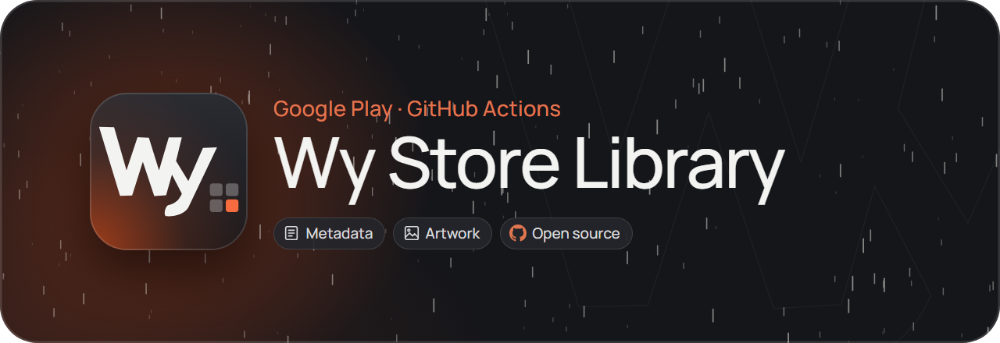
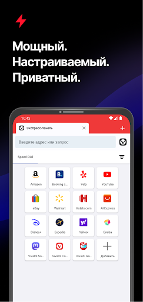
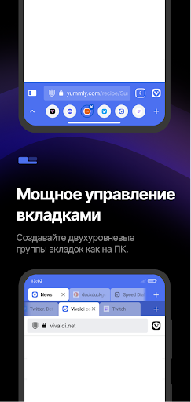
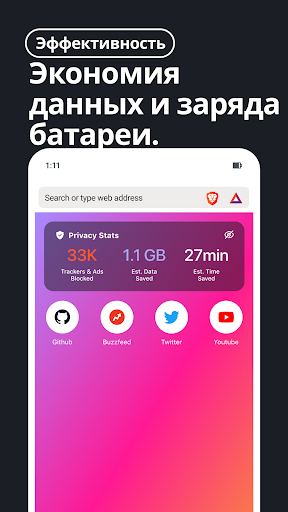
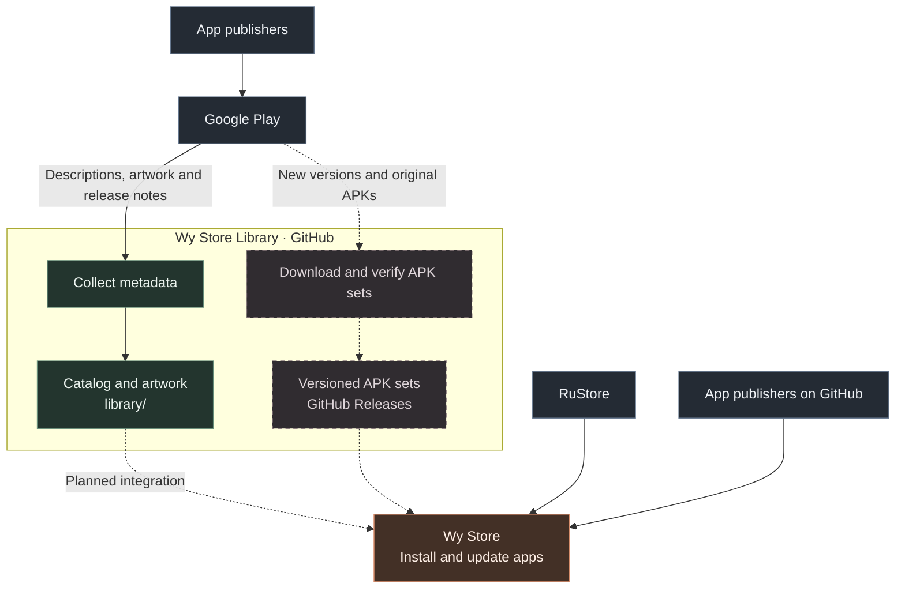

**An application library for [Wy Store](https://github.com/wyrtensi/wystore).**

App descriptions, screenshots and release notes from Google Play. 
A companion catalog preparing original app packages for Wy Store.

[**Wy Store**](https://github.com/wyrtensi/wystore) · [**Download Wy Store**](https://github.com/wyrtensi/wystore/releases/latest/download/wystore.apk) · [**Catalog**](library/catalog.json) · [**APK releases**](https://github.com/wyrtensi/wystore-library/releases)

## Explore the library

<table>
<tr>
<td width="25%" align="center" valign="top">
 
<strong>Planfix</strong> 
Tasks, projects and team collaboration  
<a href="library/apps/com.planfixng/metadata.json">Details &amp; release notes</a> 
<a href="https://play.google.com/store/apps/details?id=com.planfixng">Google Play</a>
</td>
<td width="25%" align="center" valign="top">
 
<strong>Vivaldi</strong> 
Tabs, customization and sync  
<a href="library/apps/com.vivaldi.browser/metadata.json">Details &amp; release notes</a> 
<a href="https://play.google.com/store/apps/details?id=com.vivaldi.browser">Google Play</a>
</td>
<td width="25%" align="center" valign="top">
 
<strong>Brave</strong> 
Private browsing with built-in protection  
<a href="library/apps/com.brave.browser/metadata.json">Details &amp; release notes</a> 
<a href="https://play.google.com/store/apps/details?id=com.brave.browser">Google Play</a>
</td>
<td width="25%" align="center" valign="top">
 
<strong>Firefox</strong> 
Mozilla browser with tracking protection  
<a href="library/apps/org.mozilla.firefox/metadata.json">Details &amp; release notes</a> 
<a href="https://play.google.com/store/apps/details?id=org.mozilla.firefox">Google Play</a>
</td>
</tr>
</table>

Each app includes a full description, summary, publisher, icon, screenshots and release notes in **Russian and English**. Release-note history grows from the first successful collection.

<strong>Browse app screenshots</strong>

<table>
<tr>
<td width="50%" align="center" valign="top"><strong>Planfix</strong>  

</td>
<td width="50%" align="center" valign="top"><strong>Vivaldi</strong>  

</td>
</tr>
<tr>
<td width="50%" align="center" valign="top"><strong>Brave</strong>  

</td>
<td width="50%" align="center" valign="top"><strong>Firefox</strong>  

</td>
</tr>
</table>

Screenshots and icons come from the app publishers on Google Play. Full image sets are saved alongside each app’s metadata.

## Where the apps come from

This library uses **Google Play** as its source. Scheduled GitHub Actions collect metadata and provide a pipeline for checking, verifying and publishing app packages. Connecting the library to the Wy Store client is the next stage.

Solid lines show existing flows. Dashed lines mark APK publication being set up and planned library integration. Wy Store already supports RuStore and GitHub directly.

### Current availability

| Component | Status |
| --- | --- |
| Metadata, artwork and release notes for four apps | Published; scheduled refresh once daily |
| APK verification and publication | Authenticated version checks pass; publication setup in progress |
| Library integration with Wy Store | Planned; no Android client changes yet |

The [app catalog](library/catalog.json) and [APK index](library/index.json) are separate. The APK index is currently empty: no verified APKs have been published yet. App metadata can be browsed independently.

## How updates are prepared

1. **Check the version first.** The pipeline reads `versionCode` before downloading. Equal and older versions are skipped.
2. **Verify the package set.** Every base and split APK is checked for hashes, package name, version and signing certificate. Signing-key changes require review.
3. **Publish complete versions.** Verified files go into a versioned release before the index is updated. Published assets are never overwritten.

Each app and device profile has its own release with an app name, version,
installation instructions and verified checksums. Only a newer `versionCode`
starts a download and publication. After the new release and index are checked,
older managed releases and their tags are removed. If cleanup is interrupted,
the next run resumes cleanup without downloading or uploading that version again.

Metadata refresh runs daily at **02:43 UTC** and APK checks at **03:17 UTC**
(07:43 and 08:17 in Yekaterinburg). GitHub schedules can be delayed; manual runs
remain available.

The pipeline preserves original publisher signatures and split packages. It does not merge or re-sign APKs. The initial device profile is **Android 15 / arm64-v8a / 420 dpi**; packages are selected for that profile rather than presented as universal builds.

## For Wy Store and other clients

| Data | Location |
| --- | --- |
| App list and metadata paths | [`library/catalog.json`](library/catalog.json) |
| Descriptions, artwork and release-note history | `library/apps/<package>/metadata.json` |
| Latest complete APK sets | [`library/index.json`](library/index.json) |
| Verified files for each published version | [GitHub Releases](https://github.com/wyrtensi/wystore-library/releases) |
| Configured apps and device profiles | [`apps.json`](apps.json) |

Built as a companion source for Wy Store. Visit the main application: **[wyrtensi/wystore](https://github.com/wyrtensi/wystore)** · [project website](https://wystore.ru).

<strong>Development and maintenance</strong>

Setup, authentication, publication formats and schedule limitations are documented in the [operations guide](docs/operations.md).

Library clients receive app data only. Source credentials stay in GitHub Secrets and are excluded from public metadata and manifests.

---

Python orchestration is licensed under [MIT](LICENSE); the backend compatibility patch is [GPL-3.0-or-later](patches/LICENSE). Apps, trademarks, descriptions and artwork retain their publishers’ rights and distribution terms. Wy Store Library is independent of Google and the listed app publishers.
